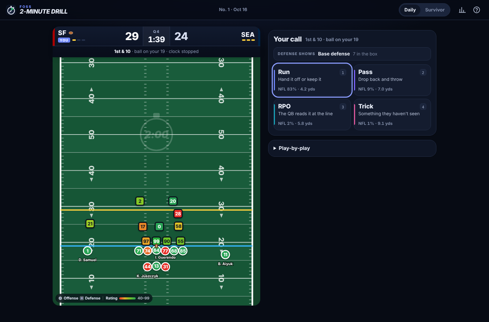
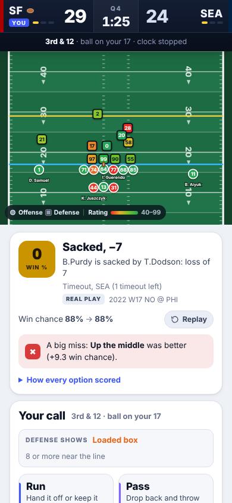

# FOSS 2-Minute Drill

Call the plays at the end of real NFL games. Every snap is a real NFL play, and every call is
graded by simulating the rest of the game thousands of times for every option you had.

A free and open-source take on the "two-minute drill" daily game: one real late-game spot a
day, plus a Survivor mode of real fourth quarters played back to back. It is built entirely
on public data from [nflverse](https://github.com/nflverse) and
[Next Gen Stats](https://nextgenstats.nfl.com). It is a static website with no server, no
ads, no analytics and no third-party requests; an optional self-hosted leaderboard is
included.

<p align="center">
  
  
</p>

## How it plays

* **The spot.** A real moment from the last minutes of an NFL game (2023–2026 seasons,
  playoffs included): the real score, clock, down, distance, field position and timeouts,
  and the 22 players who were on the field, each rated 40–99 from his production in the
  17 games before. Three kinds of spots rotate daily: *two-minute drill* (behind, need a
  score), *protect the lead*, and *tied or end of the half*.
* **Your calls.** On offense pick Run, Pass, RPO or Trick and one of 26 calls, plus the
  clock: tempo, timeouts, spikes, kneels, field goals and punts when they matter. On
  defense pick a blitz, load the box, play soft or stay base. Tries, kickoffs (onside when
  trailing) and blocking the opponent's kicks are yours too. You coach to the final whistle.
* **The snap.** The result is a real NFL play of the call you made, drawn from 155,000
  snaps (2022 onward) in the same kind of situation. Matchups tilt the odds the way they do
  on Sundays (quick throws beat the blitz, play action beats a loaded box, runs beat a light
  one) and so does team strength. The clock follows the NFL rulebook, 2025 overtime
  included.
* **The grade.** Before the result is shown, the game plays out the rest of the game for
  every option you had (500 times each, then 6,000 times for the leaders and your call,
  with common random numbers) and compares your call's win chance with the best one:
  ✓ within 0.5 points, ≈ within 2, ! within 5, ✗ worse. The result doesn't change the grade.
* **Your score.** A percentile against 4,000 simulated NFL play-callers in the same spots,
  how you did against a typical play-caller and against the real coach, and the NFL head
  coach whose late-game tendencies (pass rate, deep shots, fourth-down aggression, two-point
  tries) your calls look most like.

The engine's win chances are calibrated against what actually happened: across 984 spots,
two-minute drills are won 25% of the time in simulation and 27% in reality, leads protected
89% vs 89%.

## Run it locally

```sh
npm run serve          # python3 -m http.server 8000 --directory web
# open http://localhost:8000
```

The repository ships with the generated data, so no build step is needed to play.

## Tests

```sh
npm test                                   # engine, UI smoke test (if Playwright is installed), leaderboard
pip install -r pipeline/requirements.txt
python -m pytest tests/python              # pipeline + data-contract validation
node tests/engine/bench.mjs                # simulation speed on the real data
```

## Rebuilding the data

```sh
pip install -r pipeline/requirements.txt
python -m pipeline.build                   # --seasons 2022-2026 --spot-seasons 2023-2026 --out web/data
```

The pipeline downloads the nflverse releases it needs (play-by-play, participation, FTN
charting, rosters, player stats, snap counts, Next Gen Stats, schedules) into `.cache/`,
then writes `web/data/`. Player top speeds come from the public Next Gen Stats site API
(`nextgenstats.nfl.com/api/leaders/speed/...`): requests carry no cookies or credentials,
are throttled to one a second and cached, and the step is optional (`--no-ngs-api` falls
back to position-group speeds). Only derived numbers are written to `web/data`, never raw
API responses. A scheduled GitHub workflow rebuilds the data weekly during the season and
opens a pull request.

[`docs/DATA.md`](docs/DATA.md) documents every generated file;
[`docs/ENGINE.md`](docs/ENGINE.md) documents the engine, its rules and its API.

## Project layout

```
pipeline/         Python data pipeline (nflverse + Next Gen Stats -> web/data)
web/              the static site
  data/           generated data (calls, play library, models, spots, coaches)
  js/engine/      game engine: rules, play resolution, computer play-caller, simulation, grading
  js/ui/, app.js  the interface: screens, field, animation, storage, sharing
server/           optional leaderboard (Cloudflare Worker + D1)
tests/            node tests (engine, UI, server) and pytest tests (pipeline, data contract)
docs/             data contract and engine design
```

## Deploying

* **GitHub Pages**: enable Pages with "GitHub Actions" as the source; the
  `Deploy to GitHub Pages` workflow publishes `web/` on every push to `main`. Any static
  host works: serve the `web/` directory.
* **Leaderboard (optional)**: see `server/wrangler.toml.example` to deploy the Cloudflare
  Worker and its D1 database, then put its URL in `<meta name="board-api">` in
  `web/index.html`. Without it, the game keeps everything in the browser.

## Data and credits

* Play-by-play, participation, rosters, player stats, snap counts and schedules:
  [nflverse](https://github.com/nflverse/nflverse-data) (CC BY 4.0).
* Charting (play action, screens, RPOs, blitzers, boxes): FTN Data via nflverse
  (CC BY-SA 4.0).
* Next Gen Stats (passing, rushing and receiving metrics via nflverse; player top speeds
  via the public NGS site API): © NFL, used for derived values only.

Thanks to the nflverse maintainers and contributors, who make football analytics open to
everyone.

## Licenses

* Code: [MIT](LICENSE).
* Generated data in `web/data/`: [CC BY-SA 4.0](https://creativecommons.org/licenses/by-sa/4.0/),
  as required by the FTN charting it includes.

## About this project

This is an independent, clean-room reimplementation inspired by the game at
nfl2mindrill.com. That site's publicly served pages and scripts were analysed and its
mechanics written up as a plain-language functional specification; the code here was
written independently from that specification. All code, data processing, models and
design in this repository are original and contain none of that site's code, data or
assets.

Not affiliated with, endorsed by or sponsored by the National Football League, its teams,
its players or the NFL Players Association. NFL, team names and player names are trademarks
or property of their respective owners and are used only to identify the real games the
spots come from. No team logos are used.
